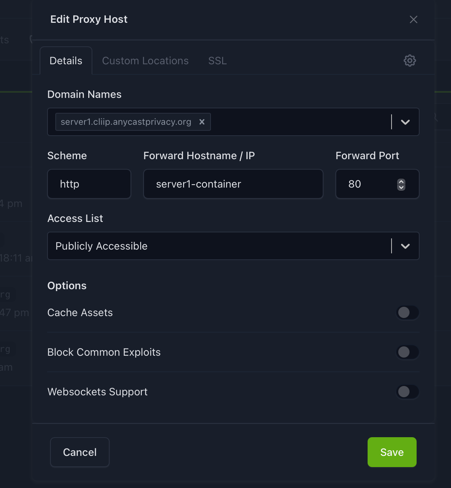

# Ingress service

## Nginx

- [Official Site](https://nginxproxymanager.com/)

### Deployment

#### Docker Compose

- [Deployment documentation](https://nginxproxymanager.com/setup/)

```shell
make ingress
```

This setup produce this ports exposed:

| Host Ports  | Container Ports | Description             |
| ----------- | --------------- | ----------------------- |
| 80          | 80              | HTTP traffic            |
| 443         | 443             | HTTPS traffic           |
| 10083       | 81              | Administration Panel    |

The proxy does not share any docker network with the other services. It
forwards the traffic to the port each service publishes on its host, so the
services can live on a different machine than the ingress.

### Backup and restore

Cold copy of its volumes (configuration, database and certificates). See
[backups](../../docs/backups.md).

```shell
make backup-ingress
make restore-ingress
```

### Proxy host configuration

Once your service is running and publishing its port on the host, you can
configure the routing rule through the web administration panel:

1. Access to the proxy hosts panel.

2. Create a new Proxy Host.

3. Configure the following fields in the Details tab:

    1. **Domain Name:** `yourdomain.com`.
    2. **Scheme:** HTTP/HTTPS (how nginx communicates with the container)
    3. **Forward Hostname / IP:** LAN IP of the machine running the service.
       Do not use `localhost`, inside the proxy container it points to the
       container itself.
    4. **Forward Port:** the port published on that host (e.g. `10101` for
       Firefly III).
    5. (Optional) Enable SSL with Let’s Encrypt in the SSL tab.

4. Save the configuration.



---
